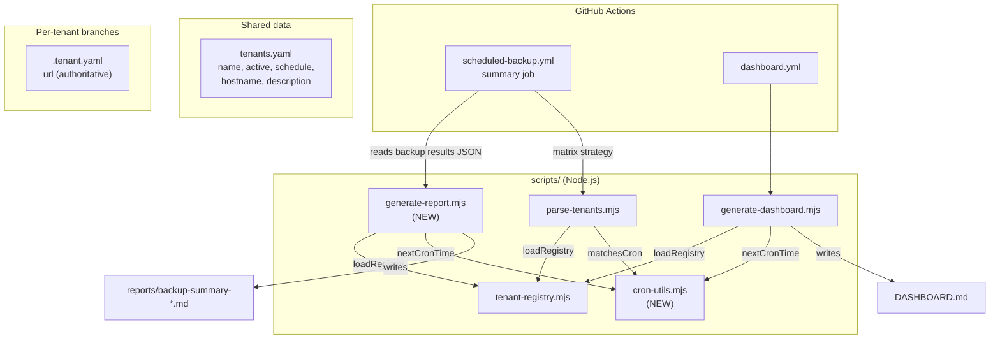

## Context

The repository's `tenants.yaml` is a flat list of tenants (name, active, schedule) used by `scheduled-backup.yml` to build a CI matrix and by `dashboard.yml` to render `DASHBOARD.md`. Operators reading the resulting tables cannot answer two basic questions:

- *Which ISC environment is this row about?* The tenant name (`company12926-poc`) is opaque without the API hostname.
- *When is the next backup?* The schedule column shows the cron expression but not the next time it fires.

The authoritative URL for each tenant continues to live in `.tenant.yaml` on the tenant's branch (per ADR-0002). The `hostname` field introduced here is a *display reference*, not a redirect target.

Two surfaces need updating: the dashboard (`DASHBOARD.md`) and the per-run summary report (`reports/backup-summary-*.md`). The dashboard already has a JS generator; the report is built inline in the workflow's bash. Refactoring the report to JS removes the inline jq/bash and lets us share the same cron utility with the dashboard.

## Goals / Non-Goals

**Goals:**

- Add a `hostname` reference and a `description` label to every tenant entry in `tenants.yaml`.
- Compute the *next backup time* for any tenant from its cron expression and surface it in both tables.
- Share the cron-matching logic across the dashboard, report, and matrix parser so it lives in one place.
- Replace the inline bash in `scheduled-backup.yml` with a `generate-report.mjs` script (same refactor pattern as the existing dashboard).

**Non-Goals:**

- Changing which URL the backup actually targets. `.tenant.yaml` on each branch remains the source of truth for the API URL.
- Storing computed "next backup" in `tenants.yaml` — it is always recomputed from the cron expression.
- Updating the manual `backup.yml` workflow — it backs up a single tenant from its own branch and has no summary table.

## Decisions

### 1. Hostname lives in `tenants.yaml` as a reference, not in `.tenant.yaml`

**Rationale**: the hostname is a *display* property used by humans reading the dashboard/report; it is not consumed by any code path that resolves the actual backup target. Putting it in `tenants.yaml` keeps it co-located with `name`, `schedule`, and `description` — fields that already live there for the same reason. `.tenant.yaml` keeps its existing role (authoritative URL for the CI secrets and restore tooling).

**Alternatives considered**:

- *Read hostname from `.tenant.yaml` on each branch during dashboard generation*: rejected because it requires a `git show` per tenant and introduces a second source of displayable URL that could disagree with `tenants.yaml`.
- *Derive hostname from tenant name*: rejected because the hostname includes the SailPoint base domain (`identitynow-demo.com`), which is not derivable from the name.

### 2. Cron utilities extracted into `scripts/cron-utils.mjs`

**Rationale**: `parse-tenants.mjs` already has `matchesCron()` and `previousCronTime()`. Adding `nextCronTime()` for the dashboard creates a need to share the cron engine. Extracting it into a dedicated module is the smallest change that avoids duplication. The extraction is mechanical and preserves the existing public behavior of `parse-tenants.mjs`.

**Alternatives considered**:

- *Duplicate the cron logic in `generate-dashboard.mjs`*: rejected because drift between the two implementations would be hard to detect and the logic is non-trivial (~50 lines of field matching).
- *Move cron logic into `tenant-registry.mjs`*: rejected because the registry is a data parser, not a scheduler.

### 3. `generate-report.mjs` ports the inline bash from `scheduled-backup.yml`

**Rationale**: the summary job in `scheduled-backup.yml` is ~50 lines of inline `jq` that builds a markdown table. Porting it to JS:

1. Lets the report script reuse `cron-utils.mjs` for the "Next Backup" column.
2. Mirrors the pattern already established by `generate-dashboard.mjs`.
3. Makes the report logic testable in isolation (`scripts/test-generate-report.mjs`).

The summary job continues to commit `reports/backup-summary-<date>.md` to `main` — only the body that builds the file changes.

**Alternatives considered**:

- *Keep the inline bash and pipe a hostname/next-backup lookup through jq*: rejected because bash cron math is fragile and would duplicate the cron engine.
- *Have the dashboard workflow also produce the daily report*: rejected because the dashboard is a one-shot view of state across all tenants, while the report is a per-run audit trail with results from the matrix.

### 4. Daily-default tenants show `daily` literally for "Next Backup"

**Rationale**: tenants with no `schedule` field (e.g. `axa`, `andre`) are onboarded with the "daily" intent — they fire every time the scheduler checks and a backup is pending. The exact "next time" is always "the next 15-minute check window after midnight UTC" and is not useful to display. The literal string `daily` is unambiguous and matches the convention already used in the existing Schedule column.

**Alternatives considered**:

- *Compute "next midnight UTC"*: rejected because it adds complexity and may misrepresent tenants that have a partial schedule on some days.
- *Compute "next check window"*: rejected because the check cadence is an implementation detail of `scheduled-backup.yml`, not a tenant property.

### 5. New tests extend the existing test files

**Rationale**: `test-parse-tenants.mjs` already round-trips a synthetic `tenants.yaml`. `test-generate-dashboard.mjs` already exercises the row renderer. Both can grow new cases for hostname and next backup without spinning up a new test runner.

## C4 Container Diagram

The dashed box is the in-process script layer; everything outside is the existing system.

## Risks / Trade-offs

- **[Risk]** Adding `hostname` to the CI matrix changes `parse-tenants.mjs` output, which the existing `test-parse-tenants.mjs` asserts byte-for-byte. → **Mitigation**: update the test in the same task that adds hostname to the matrix.
- **[Risk]** Moving ~50 lines of inline bash into JS introduces the risk that the report format diverges subtly from the previous output. → **Mitigation**: keep the column set, row ordering, and total/skip logic identical, and add a unit test that compares the new script's output against a fixture.
- **[Risk]** The dashboard test asserts the exact row string; adding two columns will break it. → **Mitigation**: update the test in the same task that updates the row renderer.
- **[Risk]** `cron-utils.mjs` is new and untested on its own. → **Mitigation**: add `scripts/test-cron-utils.mjs` covering `matchesCron`, `nextCronTime`, and `previousCronTime` across edge cases (year boundary, leap day, no match within window).
- **[Risk]** `.github/workflows/scheduled-backup.yml` and the new `generate-report.mjs` need to agree on how the matrix results JSON is shaped. The existing workflow emits `{tenant,status,tag,schedule,size,files,...}` per matrix entry. → **Mitigation**: pass the existing JSON shape verbatim to the script; the script does not require new fields from the matrix job.

## Migration Plan

No data migration is required. `tenants.yaml` entries gain two optional fields; existing entries continue to parse. The new `hostname` field defaults to `undefined` and is rendered as `—` in tables.

Deployment:

1. Land the change with hostname/next-backoff columns populated for all four existing tenants.
2. Verify a scheduled-backup run produces a `reports/backup-summary-*.md` with the new columns.
3. Verify the dashboard workflow produces a `DASHBOARD.md` with the new columns.
4. Archive the change to roll the modified specs into the canonical `openspec/specs/`.

Rollback: revert the single PR. The schema additions are additive and do not remove any existing functionality.

## Open Questions

None. All design forks were resolved during the exploration phase (extract cron utils → new `cron-utils.mjs`; replace inline bash → new `generate-report.mjs`; daily-default → literal `daily`). No in-force ADR needs supersession.
